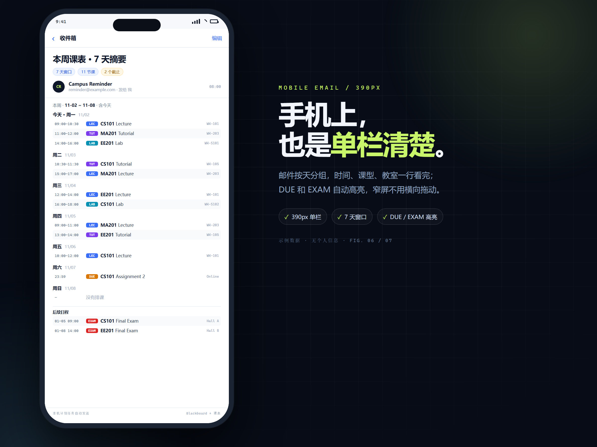
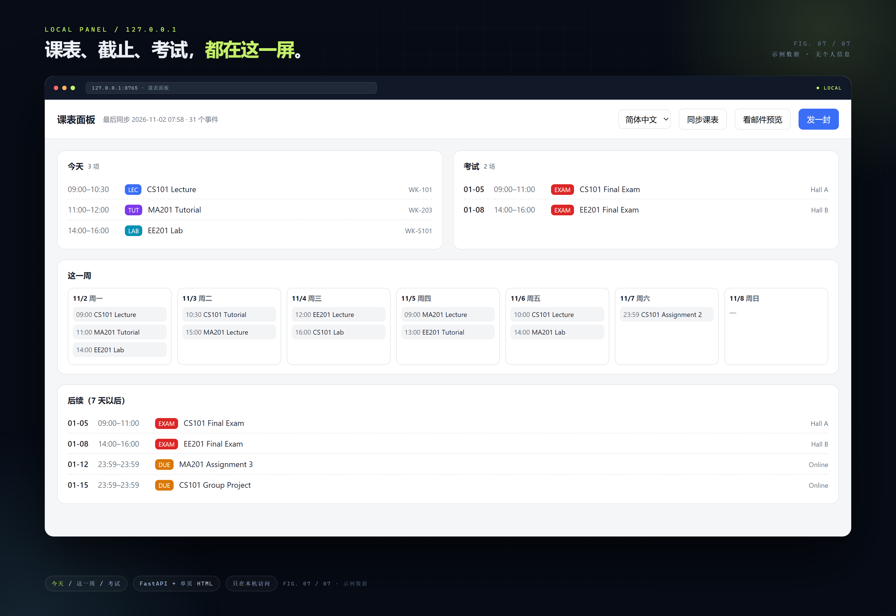

# hkcc-reminder

每天在你设定的时间，把「今天起 7 天」的课表、作业/考试截止、考试和调课告警
整理成一封邮件；同时生成可导入 Outlook 的 `.ics`。纯 Windows PowerShell 5.1，
数据留在本机，不需要云服务。

> 邮件截图是示例数据，不含个人信息。

## 一键安装（推荐）

1. 下载 [Releases](../../releases/latest) 里最新的 `hkcc-reminder-v*.zip`，解压到固定目录（装完不要移动）
2. 双击 `install.bat`，Windows UAC 选“是”
3. 按向导填写：发件邮箱、SMTP 授权码、Blackboard 日历源、提醒时间
4. 安装器会自动注册计划任务，并发送一封测试邮件
5. 收到测试邮件即完成；之后编辑 `data/timetable.ics` 和 `config/courses.psd1`

> 需要 Windows 10/11、PowerShell 5.1、管理员权限。
> 详细步骤和卸载方法见 [INSTALL.txt](INSTALL.txt)。

## 运行前提

- 到设定时间时，电脑必须**开机、联网**，并且当前 Windows 用户**已登录**
- 默认**不会唤醒睡眠中的电脑**；关机/睡眠/注销期间不发送，开机或唤醒后会补跑，但会晚于设定时间
- 需要你自己的 **Blackboard 日历源**和 **SMTP**；不是装完就自动有课表
- 面板是可选附加包，需要 Python 3.10–3.12；不在主安装包里

## 功能

- **7 天窗口**：今天起 7 个自然日，外加窗口后的后续截止预览
- **课表 + Blackboard**：合并成 `HKCC_merged.ics` / classes / deadlines，可直接导入 Outlook
- **变更监测**：对比日历源，新增 / 改期 / 换教室 / 停课会在邮件顶部告警
- **科目标注**：用 UID 映射或标题规则补上课程代号
- **调课覆盖**：公告里的调课 / 补课登记到 `overrides.psd1`，生成日历时应用
- **三语邮件**：`zh-CN` / `zh-TW` / `en`
- **零第三方模块**：核心提醒器只用 PowerShell 5.1，不调用在线模型

## 可选面板（单独下载）

面板提供今天 / 这一周 / 考试 / 后续、手动加条目、调课编辑、设置，以及
**截图/PDF 本地 OCR → 候选条目 → 勾选后写入**。

> 面板是单独的附加包：`hkcc-reminder-panel-v1.0.0.zip`（见 Releases）。
> 需要 Python 3.10–3.12，首次运行会装依赖；不在主安装包里。
> 截图为示例数据，不含个人信息。

## 隐私

- `config.psd1`、`smtp.cred.xml`、`data/*.ics`、`out/`、`logs/` 默认都在 `.gitignore`，不会入库
- SMTP / Graph 凭据用 Windows DPAPI 加密，只有本机当前账户能解密
- Blackboard `FeedUrl` 是个人 token，只放在本地配置
- 默认只发信，不读你的收件箱；读邮件模块未启用
- 仓库和安装包不含任何个人信息

## 已知限制

- 学校邮箱若强制 OAuth，`Send-MailMessage` 的简单认证可能失败；改用应用密码或换 Gmail/QQ
- Blackboard feed URL 在改密码或课程结束后可能失效，需要重新获取
- 没有自动化测试；改动后用 `-Preview` / `-NoMail` 验证
- 电脑必须在设定时间开机且已登录；补跑会迟到，不是准点

## 文档

- [手动安装 / 配置 / 排错](docs/MANUAL.md)
- [INSTALL.txt](INSTALL.txt)
- [示例课表格式](data/README.md)
- [示例配置](config/config.example.psd1)

## 状态

个人自用项目，已在 HKCC/CPCE 的真实课表上跑通。读邮件功能已实现但因租户权限限制
默认不启用，不影响课表、日历和每日邮件。
